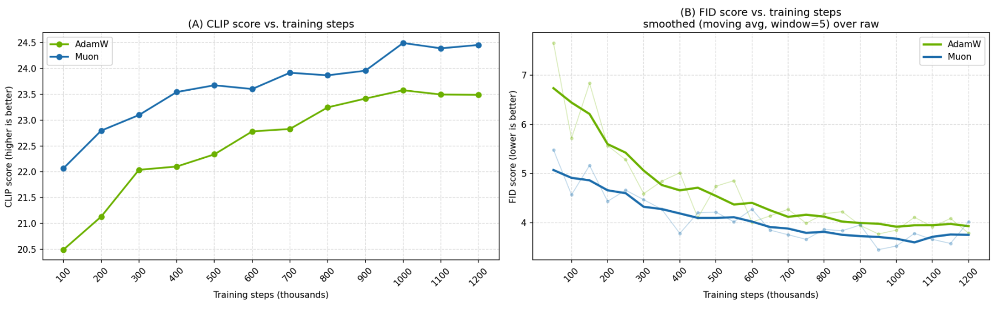
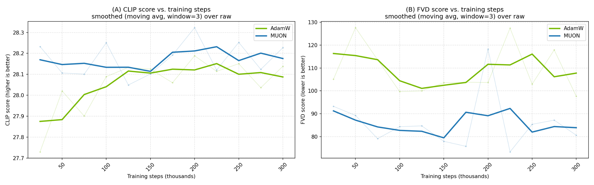

# Training Text-to-Image and Text-to-Video with Muon in Megatron Bridge

Authors: [@huvunvidia](https://github.com/huvunvidia), [@ntajbakhsh](https://github.com/ntajbakhsh)

Training a diffusion transformer from scratch requires a substantial compute budget. Can the optimizer reduce the number of steps needed to reach a given generation quality? We investigate this with a Wan2.1-style 1.3B-parameter model in [NVIDIA NeMo Megatron Bridge](https://github.com/NVIDIA-NeMo/Megatron-Bridge), comparing AdamW with a tuned Muon configuration across text-to-image and text-to-video training.

In the image phase, Muon matches AdamW's quality in roughly **2–3× fewer training steps**, with a **7.3% increase in time per step**. In the subsequent video phase, Muon maintains a quality advantage with approximately **2% per-step overhead**. The video runs start from their respective image checkpoints, so that comparison measures the outcome of the two-stage training recipe, including the advantage established during image training.

## How Muon differs from AdamW

AdamW scales updates independently for each parameter using first- and second-moment estimates. Muon instead uses Newton–Schulz iterations to approximately orthogonalize the momentum update of each weight matrix before applying it. This gives the optimizer a matrix-level view of the large two-dimensional weights in a transformer.

[Muon is Scalable for LLM Training](https://arxiv.org/abs/2502.16982) reports approximately 2× compute efficiency over AdamW in language-model scaling experiments, using weight decay and calibrated update scaling. Here, we investigate whether similar benefits carry over to a diffusion transformer trained with a flow-matching objective and cross-attention to text.

## Experimental setup

The model uses a diffusion transformer (DiT) backbone with self-attention over visual tokens, cross-attention to a T5-family text encoder, and a causal 3D VAE for latent compression. We train in two phases and evaluate generation quality on held-out data.

| Setting | Text-to-image | Text-to-video |
| --- | --- | --- |
| Model | Wan2.1-style 1.3B DiT | Same backbone |
| Training data | 67M-image subset of [DataComp-1B](https://arxiv.org/abs/2304.14108) | [OpenVid-1M](https://arxiv.org/abs/2407.02371), approximately 1M videos |
| Resolution | 256 × 256 | 256 × 256, clips normalized to 5 seconds |
| Training steps | 1.2M | 300K |
| Initialization | From scratch | Each optimizer's own image-phase checkpoint |
| Evaluation | CLIP score and CLIP-feature Fréchet distance | CLIP score and FVD using I3D features |

For the image experiments, the metric labeled **FID** in the figures and tables uses **CLIP features rather than Inception-v3 features**. The dataset includes logos, book covers, and objects on white backgrounds, motivating this choice. These values should therefore be interpreted within this evaluation setup, rather than compared directly with conventional Inception-based FID.

## Configuring Muon for diffusion training

We first calibrate the update scale and evaluate three changes to the baseline Muon configuration.

### Match the update scale

Following the scaling recipe in the Muon paper, we measure AdamW's per-parameter update RMS and observe values in the 0.2–0.4 range. We use an update scale factor of **0.2** for Muon. This calibration allows both optimizers to use the same best-performing learning rate and reduces differences caused simply by update magnitude.

### Use Adaptive Muon

[AdaMuon](https://arxiv.org/abs/2507.11005) combines orthogonalized updates with element-wise adaptivity. In our text-to-image ablation, Adaptive Muon improves both CLIP score and FID over vanilla Muon. We use the adaptive variant for the main results; subsequent references to “Muon” denote the combined configuration described here.

### Increase Newton–Schulz iterations

We compare **5** and **20** Newton–Schulz iterations and find that 20 improves generation quality in the ablation. Combining Adaptive Muon with 20 iterations increases step time by approximately **5% relative to vanilla Muon with 5 iterations**. This comparison has a different baseline from the AdamW overhead reported in the main experiments.

### Make AdaLN parameters eligible for matrix updates

Wan modulation/adaptive layer normalization (AdaLN) parameters can be stored as three-dimensional tensors with shape `[1, 6, dim]`. A parameter-selection rule that applies Muon only to two-dimensional tensors excludes those parameters from its matrix updates.

In the experimental configuration, storing them as `[6, dim]` makes them eligible for Muon. Implicit broadcasting, or an explicit `.unsqueeze(0)` in the forward pass, preserves the required broadcast behavior. This changes optimizer eligibility without changing the intended forward computation.

The ablation runs use **64 GPUs for 35K text-to-image steps**. Each individual change is compared with vanilla Muon, followed by a run combining all three changes.

| Configuration | CLIP score ↑ | FID (CLIP features) ↓ |
| --- | ---: | ---: |
| Baseline: vanilla Muon | 21.3132 | 4.3558 |
| + Adaptive Muon | 21.7341 | 3.7757 |
| + 20 orthogonalization iterations | 21.5426 | 3.9534 |
| + Two-dimensional AdaLN parameters | 21.3161 | 4.1764 |
| **All configurations combined** | **21.9156** | **3.3507** |

*Table 1. Muon configuration ablation for text-to-image training. Higher CLIP and lower FID are better.*

## Text-to-image results

We train on the 67M-image DataComp-1B subset for 1.2M steps. Muon reaches comparable quality earlier and retains an advantage at the end of training.



*Figure 1. Text-to-image evaluation at 256 × 256 resolution. Left: CLIP score, higher is better. Right: FID computed with CLIP features, lower is better; bold curves use a five-point moving average over the raw measurements. Training steps are in thousands.*

For each evaluated AdamW checkpoint, we interpolate the number of Muon steps needed to reach the same score. The step-count speedup is the AdamW step count divided by that interpolated Muon step count.

| Metric | AdamW evaluation checkpoints | Mean step-count speedup | Median step-count speedup |
| --- | --- | ---: | ---: |
| CLIP score | 9 points, 400K–1.2M steps | 2.99× | 3.03× |
| FID (CLIP features) | 10 points, 300K–1.2M steps | 2.17× | 1.86× |

*Table 2. Steps required to reach matched quality. These ratios measure training steps, not wall-clock speedup.*

Muon takes **7.3% longer per image-training step** than AdamW. The reduction in steps outweighs that overhead, but wall-clock gains must account for it; the 2–3× step-count result should not be read as an identical increase in training throughput.

## Text-to-video results

We continue training on OpenVid-1M for 300K steps, using each optimizer's own text-to-image checkpoint. The Muon configuration carries over without retuning: Adaptive Muon, 20 Newton–Schulz iterations, update scale factor 0.2, and two-dimensional AdaLN parameters.



*Figure 2. Text-to-video evaluation at 256 × 256 resolution. Left: CLIP score, higher is better. Right: FVD using I3D features, lower is better. Bold curves use a three-point moving average over raw measurements. Training steps are in thousands.*

Muon maintains higher smoothed CLIP scores and lower smoothed FVD across the video phase. Because the two runs inherit different image checkpoints, this result does not isolate the effect of changing the optimizer during video training from the effect of its initialization. It shows that the advantage of the Muon training recipe persists through the second phase.

OpenVid-1M captions exceed CLIP's context window, so we compute CLIP scores by averaging per-sentence embeddings. Orthogonalization adds approximately **2% to step time relative to AdamW** in this phase. Video steps are more expensive overall, making the optimizer overhead a smaller fraction of each step.

## Get started

Megatron Bridge provides [Wan dataset preparation, training, checkpoint conversion, and inference examples](https://github.com/NVIDIA-NeMo/Megatron-Bridge/tree/main/examples/models/wan). After following the repository's installation instructions, run the Wan 1.3B recipe with mock data from the repository root:

```bash
uv run python -m torch.distributed.run --nproc_per_node=8 \
  scripts/training/run_recipe.py \
  --recipe wan_1_3b_pretrain_config \
  --step_func wan_step
```

This is a starting point for checking the Wan training workflow, not a reproduction of the experiments above. For real data, follow the [OpenVid-1M preparation guide](https://github.com/NVIDIA-NeMo/Megatron-Bridge/tree/main/examples/models/wan/prepare_dataset/openvid1M_dataset) and configure the dataset path as described in the Wan examples.

Muon and Adaptive Muon are integrated through [Megatron Core's emerging optimizer support](https://github.com/NVIDIA/Megatron-LM/blob/main/megatron/core/optimizer/emerging_optimizers.py). The [Bridge optimizer utilities](https://github.com/NVIDIA-NeMo/Megatron-Bridge/blob/main/src/megatron/bridge/recipes/utils/optimizer_utils.py) expose Muon configuration fields, including the number of Newton–Schulz iterations and update scaling. Reproducing the experimental configuration also requires the AdaLN parameter representation described above; selecting the optimizer alone does not make that model change.

## Conclusion

For this Wan2.1-style 1.3B diffusion transformer, the combined Muon configuration reaches matched image-generation quality in roughly 2–3× fewer steps than AdamW, with 7.3% per-step overhead. Continuing from the respective image checkpoints preserves a quality advantage during video training with approximately 2% per-step overhead. The strongest configuration in our ablation combines Adaptive Muon, 20 orthogonalization iterations, calibrated update scaling, and two-dimensional AdaLN parameters.
