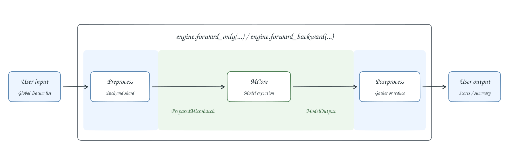

# TrainingEngine

`TrainingEngine` provides an in-process interface for scoring and training Megatron models. A `TrainingRecipe` describes the model and its execution configuration; the engine builds that configuration and exposes operations that an RL framework or application can compose into its own training loop.

The application owns rollout, environments, rewards, advantage estimation, algorithm scheduling, and inference-policy updates. Each engine owns one model, its optimizer when trainable, and its pending gradient accumulation state.

> **Mathematical choices belong to the user.**
>
> **Distributed implementation belongs to the engine.**

In practice:

- Users choose the objective, loss weights, normalization policy, and optimizer-step boundaries.
- The default engine pipeline handles packing, DP/CP partitioning, Megatron execution, gradient synchronization, and reconstruction of scoring outputs.
- Users can replace preprocessing, postprocessing, and loss methods without changing the public training loop. Custom pipelines must still satisfy the strict execution contract.

Functionality that is not implemented yet is listed in [TODO.md](TODO.md); the engine rejects those modes explicitly instead of silently ignoring them.

## API walkthrough

### Construct, score, accumulate, update

Run the application under a distributed launcher with the world size required by the recipe. **Every rank constructs the engine and enters distributed operations in the same order.** This is an every-rank API, not a rank-0 client that dispatches work to other ranks.

```python
from megatron.bridge.engine import AdamParams, Datum, TrainingEngine

model = "/models/qwen35-text-35b-a3b"  # HF model ID or local model directory
initial_checkpoint = "/checkpoints/initial-policy"
policy = TrainingEngine(
    model,
    seq_length=32768,
    checkpoint_path=initial_checkpoint,
)


def update_policy(
    policy: TrainingEngine,
    batches: list[list[Datum]],
    learning_rate: float,
) -> dict[str, float]:
    # The application has already generated responses, computed advantages,
    # and populated rollout_logprobs. Each batch is global and identical on all ranks.
    for batch in batches:
        scored = policy.forward_only(batch)
        for datum, logprobs in zip(batch, scored.logprobs):
            datum.old_logprobs = logprobs

        policy.forward_backward(
            batch,
            loss_fn="ppo_clip",
            loss_kwargs={"clip_low": 0.2, "clip_high": 0.28, "tis_coef": 2.0},
        )

    # Weights stayed unchanged across all scoring and backward calls above.
    # Normalize the accumulated gradients once, then update the policy.
    return policy.optim_step(AdamParams(learning_rate=learning_rate))


# The application calls update_policy(...) for each optimizer update.
# Check result["update_successful"] before counting a successful update.
# Call policy.close() when the application finishes using this model.
```

`forward_only` scores supplied targets; it does not generate responses. The application decides which policy snapshot supplies `old_logprobs`. `rollout_logprobs` are the generation backend's probabilities and remain a separate field for training–inference correction.

An engine can also represent a frozen reference or a trainable critic:

```python
reference = TrainingEngine(
    model,
    seq_length=32768,
    checkpoint_path=initial_checkpoint,
    trainable=False,
)
critic = TrainingEngine(
    model,
    seq_length=32768,
    checkpoint_path=initial_checkpoint,
    output_head="value",
)
```

Each engine owns its recipe, model, and training state; engines in one process share a compatible distributed topology. A value-head engine replaces the language-model output head with a scalar value head and disables MTP; its default training loss is `value_loss`. Move engines between CPU and GPU when they cannot remain resident together.

### Operations and results

| Operation | Contract |
|---|---|
| `TrainingEngine(model, seq_length=..., ...)` | Select a registered recipe using the model config, hardware, and context length, then build the engine. |
| `TrainingEngine.from_recipe(recipe, ...)` | Build from an explicitly supplied recipe, deep-copied for this engine. |
| `forward_only(data, gather_output=True)` | Return a detached `ForwardOutput` with target logprobs or critic values. Preserve pending gradients. `disable_adapters=True` scores a LoRA engine's frozen base model. |
| `forward_backward(data, loss_fn=None, loss_kwargs=None)` | Compute the selected loss and accumulate gradients. Return a `ForwardBackwardOutput` for this call; do not update weights. |
| `optim_step(adam_params, normalize_gradients=True)` | Apply the selected update-wide normalization, finalize distributed gradients, and step the optimizer. Clear the accumulation window afterward. |
| `zero_grad()` | Discard pending gradients and reset the accumulation window. |
| `cpu()` / `cuda()` | Offload and restore model parameters, optimizer state, and pending accumulation gradients. Calls are idempotent. |
| `save_state(path, user_state=None, async_save=False)` | Save resumable training state at a closed accumulation window; return a `CheckpointHandle`. |
| `load_state(path)` | Restore training state from a checkpoint root or iteration directory; return this rank's saved `user_state`. |
| `export(path=...)` / `export(streaming=True)` | Export language-model weights in the recipe's HF layout, to a directory or an iterator of `(name, tensor)` pairs. LoRA adapters are merged in; `adapter_only=True` exports them alone in the HF PEFT layout (a PEFT directory needs `base_model_name_or_path`, the HF model the adapters were trained on). |
| `close()` | Wait for any pending save and release the engine. Other engines and the shared runtime remain available. |

`AdamParams` supplies the learning rate, betas, epsilon, and weight decay for that step. The learning-rate schedule belongs to the application. Recipe parameter-group multipliers still apply.

`lora=LoraConfig(rank=..., alpha=...)` at construction trains LoRA adapters on a frozen base loaded from `checkpoint_path`: the gradient buffers, the optimizer and `save_state` hold the adapters only, and `forward_only(disable_adapters=True)` replaces a separate reference engine. `target_modules=None` uses the recipe's `lora_target_modules` (Qwen3.5 adds its GatedDeltaNet `in_proj` and `out_proj` to Bridge's four default linears). Routing stays the base model's: no MoE router may match a target, router expert biases are frozen, and quantile-balanced routing is rejected. `expert_adapters` picks Bridge's layout for MoE expert adapters (`"shared"`, the default, `"per_expert"` or `"outer_shared"`), and on a vision-language recipe plain target names skip the parts the recipe freezes. `save_state` records the LoRA settings, and `load_state` refuses a checkpoint saved with other settings.

Predefined loss methods are additive over active token positions:

| Loss method | Required data beyond inputs, targets, and masks |
|---|---|
| `cross_entropy` | None; this is the language-model default. |
| `importance_sampling` | `advantages`, `old_logprobs`; `rollout_logprobs` when `tis_coef` is set. |
| `ppo_clip` | `advantages`, `old_logprobs`; `clip_low` and `clip_high` in `loss_kwargs`. Optional `reference_logprobs` with positive `kl_beta`, and `rollout_logprobs` with `tis_coef`. |
| `value_loss` | A value-head engine and `loss_inputs["returns"]`; also `loss_inputs["old_values"]` when clipping is enabled. |

See [losses.py](losses.py) for the precise objectives, numerical handling, and diagnostic metrics. Runnable applications are in [examples/engine](../../../../examples/engine/README.md), including GRPO/PPO with vLLM, checkpoint/resume, CPU/GPU movement, and router replay.

## Some technical design details

### Recipe usage

Use **`TrainingEngine(model, seq_length=...)`** for automatic recipe selection. `model` can be an HF model ID or a local directory; `seq_length` is the packed token budget per microbatch.

The engine matches the model's HF configuration, filters recipes by GPU family, and picks the smallest registered context bucket covering the requested length. Hardware is detected automatically unless `hardware` is supplied. The requested sequence length is passed to the recipe unchanged and must satisfy its alignment requirements. Unsupported combinations raise an error listing the available recipes.

```python
policy = TrainingEngine(
    model,
    seq_length=32768,
    hardware="GB300",  # Optional; omit to detect the local GPU family.
    checkpoint_path=initial_checkpoint,
    overrides={"router_replay": True},
)
```

`overrides` changes existing recipe fields by dotted path, such as `router_replay` or `optimizer.clip_grad`; unknown paths raise. `hf_revision` optionally pins the HF configuration revision.

The [registry](recipes/registry.py) currently selects the Qwen3.5-35B-A3B recipe on GB300 for lengths up to 131072 tokens, divisible by 16.

**GPU scaling:** launch with a GPU count that is a multiple of the recipe's minimum requirement (16 GPUs for the current Qwen3.5 recipe). Extra GPUs increase data parallelism while the recipe's model-parallel settings stay fixed. The application controls the global batch size.

For explicit configuration, construct or customize a recipe and use **`from_recipe`**:

```python
from megatron.bridge.engine.recipes import qwen35_text_35b_a3b_rl_16gpu_gb200_bf16

recipe = qwen35_text_35b_a3b_rl_16gpu_gb200_bf16(hf_path=model, seq_length=32768)
recipe.router_replay = True
policy = TrainingEngine.from_recipe(recipe, checkpoint_path=initial_checkpoint)
```

Both paths use the same engine initialization and runtime checks. **The model argument selects the configuration; `checkpoint_path` supplies pretrained weights.** Omitting the checkpoint uses the model config's initialization.

### Data contract

**The engine input is extensible; the boundary into Megatron is strict.** The default global-batch pipeline handles data preparation and output reconstruction for the caller.



*Blue — loose contract: input/output representations and preprocessing/postprocessing are customizable. The default Datum fields and training-summary counts still have defined contracts.*

*Green — strict contract: prepared inputs and local model outputs have explicit shapes, dtypes, layout, and alignment. This constrains the execution data, not the user's choice of loss mathematics.*

By default, callers provide the **same global `list[Datum]` on every rank**, with one Datum per unpadded sample. Users do not need to partition that batch themselves.

- **Preprocess:** the engine assigns work across DP ranks, packs samples into THD microbatches, and applies CP sharding to tokens and their associated RL fields.
- **Postprocess:** `forward_only` gathers scores back into the original sample order by default; `gather_output=False` returns local portions. `forward_backward` returns a globally reduced loss/count summary while gradients remain accumulated in the engine.

Users with a different data pipeline can override preprocessing and postprocessing. Preprocessing must still produce valid `PreparedMicrobatch` inputs for MCore, and training summaries must preserve the counts used for normalization. See [datum.py](datum.py) for field definitions and [batching.py](batching.py) for the default pipeline.

### Custom losses and gradient accumulation

#### Custom loss

Subclass `TrainingEngine` and select the loss method by name. It receives this rank's `PreparedMicrobatch` and autograd-connected `ModelOutput` for one microbatch. By default, return a **summed scalar loss**, leaving normalization to `optim_step`.

```python
import torch
from megatron.bridge.engine import ModelOutput, PreparedMicrobatch, TrainingEngine


class MyEngine(TrainingEngine):
    def policy_gradient(self, batch: PreparedMicrobatch, output: ModelOutput) -> torch.Tensor:
        active = batch.active_mask  # loss_mask excluding padding
        return -(output.logprobs[active].float() * batch.advantages[active].float()).sum()


# engine = MyEngine(model, seq_length=32768, checkpoint_path=initial_checkpoint)
# engine.forward_backward(global_batch, loss_fn="policy_gradient")
```

Loss methods may also return additive diagnostic metrics alongside the scalar. See [losses.py](losses.py) for reference implementations. Objectives needing additional communication can access `engine.process_groups`.

#### Gradient accumulation

- Each `forward_backward` call adds **FP32 gradient sums** without updating weights. A call can contain multiple microbatches, and accumulation continues across calls.
- `optim_step` normalizes once by the **global active-token count across the whole accumulation window** by default, finalizes distributed gradients, updates weights, and clears the window. There is no extra division by the number of calls or microbatches.
- `zero_grad` discards the pending gradients and resets the window.

Set `engine.normalization` before accumulation: `TOKEN_MEAN` is the default, `SAMPLE_MEAN` divides by the number of Datums, and `NONE` disables normalization. If your custom loss already normalizes across the intended update, use `NONE` or `optim_step(..., normalize_gradients=False)` to avoid scaling twice.

MTP and MoE auxiliary gradients receive the same final engine scaling while retaining MCore's internal weighting. Disabling normalization also affects those gradients. Implementation details are in [accumulation.py](accumulation.py) and [optim.py](optim.py).
